# Better Draft v0 (0.1.0): relatório

18/11/2026. Branch `feature/better-draft-v0`, sem push e sem merge.

## Artefato

| Item | Valor |
| --- | --- |
| ZIP | `addons/better_draft.zip`, 2 734 259 bytes |
| SHA256 | `E7CDE78D1E347B64599CF31B88A11443BADBC781BA2F46BFF1D6688656F57C84` |
| Origem | `git -c core.autocrlf=false archive HEAD:src/better_draft` no commit `4db8b93`; nenhum `.py`/`.toml` com CRLF |
| Validação | `blender --command extension validate` (4.2.0): sem erros |
| Conteúdo | código do addon, `LICENSE` (GPL-3.0), wheels ezdxf 1.4.5, fonttools 4.68.0, pyparsing 3.3.3, typing_extensions 4.16.0 |

## O que foi testado, e onde

Executado nesta sessão, em portáteis Windows x64 conferidos por SHA256, cada um com perfil novo e isolado. O ZIP acima foi instalado com `--offline-mode --command extension install-file`.

| Bateria | 4.2.0 | 4.5.16 LTS | 5.3.0 |
| --- | --- | --- | --- |
| `test_wheel_install.py` (ezdxf importado da extensão, DXF escrito e relido) | passou | passou | passou |
| `test_blender_v0.py` (16 casos de ponta a ponta; DXF relido com ezdxf e com um leitor mínimo de códigos de grupo escrito no teste, as duas leituras conferidas uma contra a outra) | 16/16 | 16/16 | 16/16 |
| `test_recognition.py` (26) e `test_parts.py` (13), fora do Blender | Python 3.11.7 do 4.2.0 e 3.13 do 5.3 instalado: todos passaram | | |
| Calibração (`calibrate.py`, 631 linhas) | sim | não | sim |

Resultados brutos: `tests/better_draft/results/0.1.0/`.

Casos de ponta a ponta: em cada exportação o teste compara uma impressão digital da cena antes e depois (objetos, malhas, textos, matrizes, seleção, vértices, arestas, faces, atributos, modo). Uma recusa também tem de terminar sem nenhum arquivo novo.

| Caso | Verifica |
| --- | --- |
| registro | operador e entradas em File > Export, menu de contexto e menu Edge do Edit Mode |
| retângulo com Bevel (modificador, 8 seg.) | 4 ARC R 5 nos centros certos, 4 LINE de 10 e 30 mm, camada OUTER, `$INSUNITS` = 4, relatório `.txt` |
| chapa com furo de 32 seg. | CIRCLE R 8 em (30, 20) na camada INNER |
| furo hexagonal | 6 LINE com o padrão; CIRCLE com mínimo de círculo 6 |
| escala de cena 0,001; objeto escalado 2,5×, rotacionado e deslocado | raios 5 e 12,5 mm |
| normal virada para baixo | DXF idêntico ao da face virada para cima (sem espelhar) |
| chapa com espessura (Bevel + Solidify) | região da maior face, 4 ARC |
| Mark as Arc + Undo | atributo nas 3 arestas certas; exportar indisponível em Edit Mode; Undo remove as marcas; vértices intactos; facetado de 3 segmentos vira 1 ARC R 5 |
| Mark as Automatic sem marcas | não cria o atributo |
| "linhas" vence "arco" | canto com aresta "linhas" e arestas "arco" sai como linhas; os outros 3 cantos, ARC |
| arco forçado fora da tolerância | recusa com o desvio medido e o que fazer |
| peças soltas | Stop recusa (2 partes + 1 abaixo da área mínima); Largest exporta 1; All exporta 2 lado a lado com 5 mm |
| peças iguais / mesma área | cópia girada 40°: exporta uma; mesma área com formas diferentes: recusa |
| recusas | face torta, contorno que se cruza, furo tocando o contorno num vértice, World XY com peça inclinada, malha sem faces |
| um objeto ruim no lote | nenhum arquivo para nenhum objeto |
| um arquivo com dois objetos / um por objeto | peças lado a lado sem sobreposição; nomes `<arquivo>_<objeto>.dxf` |

## Mensagens de recusa (texto real)

- `warped: the reference face (largest) is not flat within 0.01 mm. In Edit Mode make a flat face active, or raise Fit Tolerance.`
- `rr: 7 edges marked as arc near (20.000, 18.380) mm do not fit one circle within 0.01 mm (deviation 0.5670 mm). Mark them Automatic or Lines, raise Fit Tolerance, or correct the vertices.`
- `parts: has 2 separate parts (plus 1 below the minimum area). Set Loose Parts to Largest or All in the export options, or separate them (Mesh > Separate > By Loose Parts).`

Todas começam com `Nothing exported.`

## Decisões de implementação a conferir

- **Lado do desenho:** o contorno é visto do +Z do objeto (ou +Y, +X para peça em pé). Sem isso, uma chapa com a normal para baixo saía espelhada; achado e corrigido nesta sessão.
- **Peças soltas:** são agrupadas por arestas compartilhadas. Duas faces que só se tocam num vértice contam como peças separadas.
- **Espaçamento padrão de 10 mm** entre peças lado a lado: escolhido por mim, sem dado de calibração.
- **Gravação dos arquivos:** primeiro tudo vai para arquivos temporários na mesma pasta; os arquivos finais só são substituídos depois que todos foram escritos. Uma falha no meio da troca final (depois de todas as gravações) não é revertida.
- **Relatório completo:** sai em `.txt` ao lado do DXF, não num bloco do Text Editor, porque isso criaria um dado novo na cena. O resumo vai para o aviso do Blender.

## Fechamento das lacunas (18/11/2026, segunda rodada)

Mesmo ZIP em todos os itens: `addons/better_draft.zip`, SHA256 `E7CDE78D1E347B64599CF31B88A11443BADBC781BA2F46BFF1D6688656F57C84`. Nenhum teste revelou defeito no addon, então o código e o ZIP não mudaram. Os scripts de teste foram ajustados (detalhes em cada item). Resultados em `tests/better_draft/results/0.1.0/`.

| Item | Estado | Versões | Resultado | Arquivos |
| --- | --- | --- | --- | --- |
| 1. DXF em programas independentes | testado (ODA, LibreCAD, FreeCAD) | DXFs do 5.3.0 | ver 1 | `external/` |
| 2. Interface com janela | testado | 4.2.0, 4.5.16, 5.3.0 | 16/16 verificações em cada versão | `gui-*.json`, `gui-*/*.png` |
| 3. Versões que faltavam | testado | 4.3.2, 4.4.3, 5.0.1, 5.1.2, 5.2.4 | wheel OK e 16/16 em todas | `e2e-*.json`, `wheel_test-*.json` |
| 4. Conflito de bibliotecas | testado | 4.2.0, 4.2.23, 4.5.16, 5.3.0 | sem conflito com as preferências carregadas; uma falha só no 4.2.0, num cenário específico | `conflict-*.json` |
| 5. Marcações sob modificadores | testado | 4.2.0 | as marcas chegam à malha avaliada nos 5 modificadores; resultado varia | `study-modifiers-4.2.0.json` |
| 6. Desempenho | testado | 4.2.0, 5.3.0 | chapa grande 2,7 a 3,2 s; 20 objetos 0,34 a 0,39 s | `study-performance-*.json` |
| 7. Offline de verdade | **não testado** | — | exige regra de firewall; ver 7 | — |

Todas as baterias rodaram em portáteis Windows x64 conferidos por SHA256, com perfil novo e isolado e o ZIP instalado com `--offline-mode`. O Blender instalado não foi usado.

### 1. DXF validado por programas independentes do ezdxf

Entrada: os 18 DXFs gerados pela bateria de ponta a ponta no 5.3.0 (`results/0.1.0/external/input/`).

| Programa | Versão e origem | Como | Resultado |
| --- | --- | --- | --- |
| ODA File Converter | 27.10.0.0; MSI do site da Open Design Alliance, assinatura válida; extraído com `msiexec /a` para uma pasta, sem instalação | DXF → DWG (ACAD2018, auditoria ligada) → DXF; a ida e volta é comparada com o original pelo leitor próprio (`external/dxf_raw.py`) | 18/18: nenhum arquivo `.err`; mesmas entidades (tolerância 1e-6 mm), mesmas camadas e `$INSUNITS = 4` |
| LibreCAD | 2.2.1.6; instalador do GitHub do LibreCAD (sem assinatura digital); só extraído com 7-Zip | `LibreCAD.exe dxf2png -r 1000x700 -o <png> <dxf>` | 18/18 PNG gerados, código de saída 0; imagens abaixo |
| FreeCAD | 1.1.4 (build 20260928); `.7z` portátil do GitHub do FreeCAD, SHA256 `4828741F…4D6D` conferido com o publicado; perfil isolado em `FREECAD_USER_HOME` (nada gravado em `%APPDATA%`) | `FreeCADCmd.exe external/freecad_check.py`: importador DXF em C++ (`Import.readDXF`), sem interface; cada aresta vira LINE, ARC ou CIRCLE e é comparada (tipo, quantidade, pontas, centro, raio, ângulos) com o leitor próprio e com a geometria conhecida de cada caso (tabela `KNOWN` no script) | 18/18: quantidades iguais e nenhuma diferença acima de 1e-4 mm (leitor) / 1e-3 mm (geometria conhecida) |

Efeito colateral: o LibreCAD grava as preferências dele no registro do Windows e, na primeira execução, criou a chave `HKCU\Software\LibreCAD`. Não removi a chave.

Imagens do LibreCAD (`results/0.1.0/external/librecad-png/`):

| | | |
| --- | --- | --- |
|  rounded_rect |  hole | 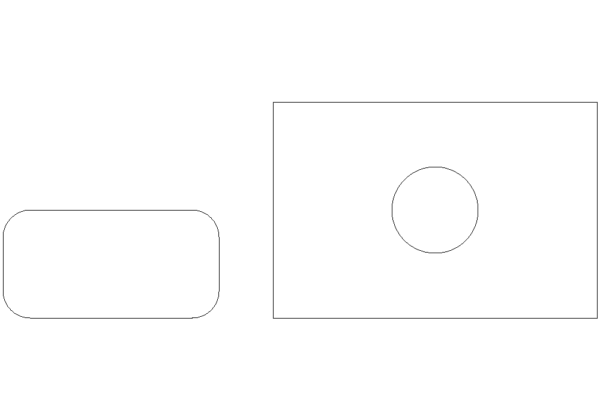 single |
| 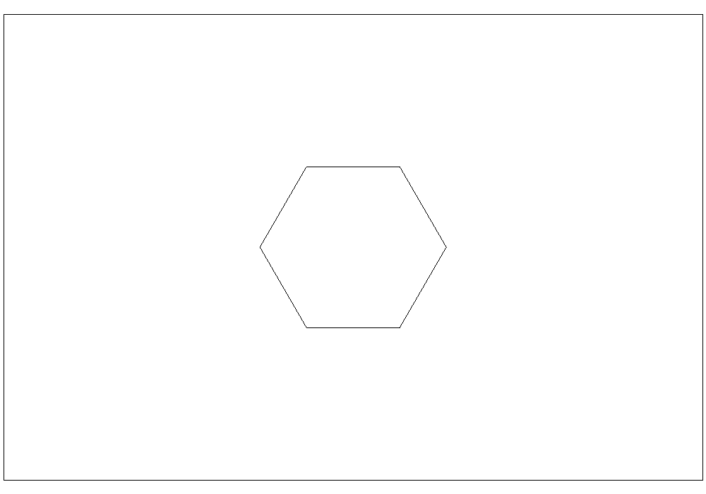 hex_default |  hex_min6 |  scaled_rotated |
| 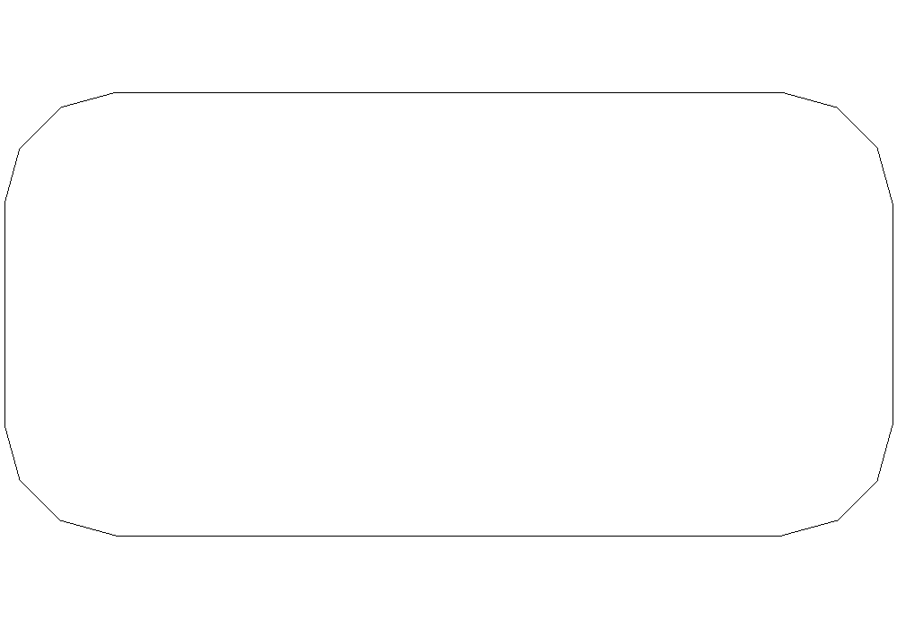 facets_auto | 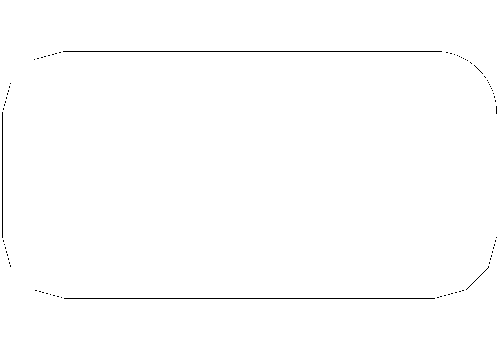 facets_marked | 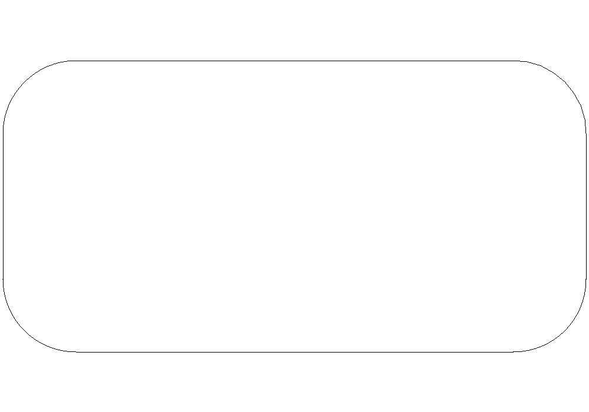 lines_win |
| 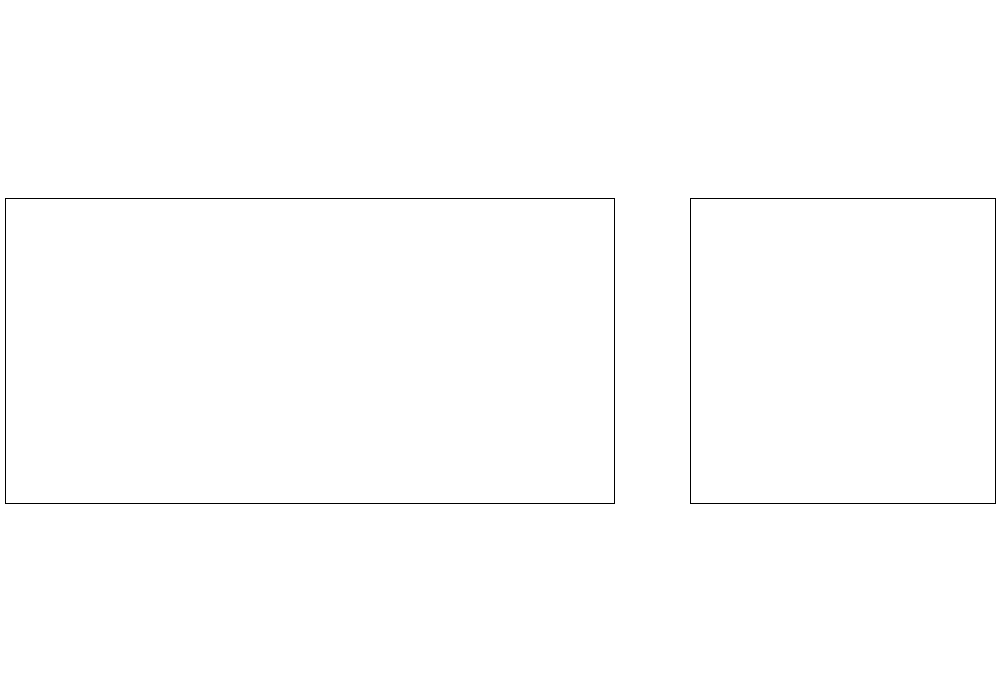 parts_all | 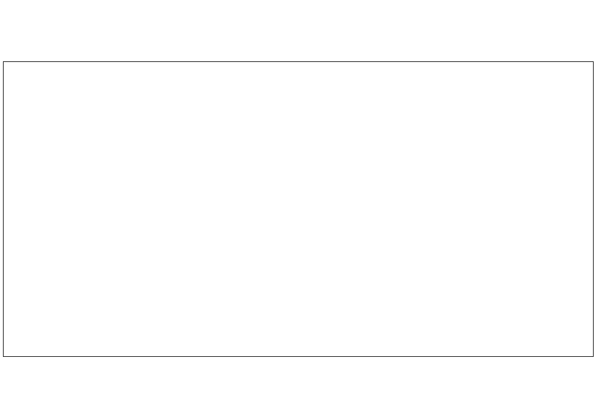 parts_largest | 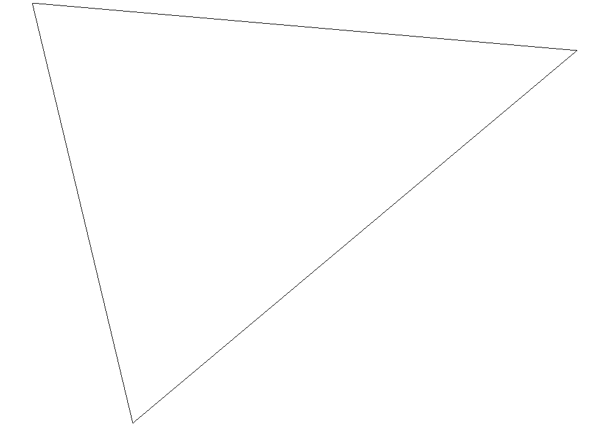 twins_largest |
| 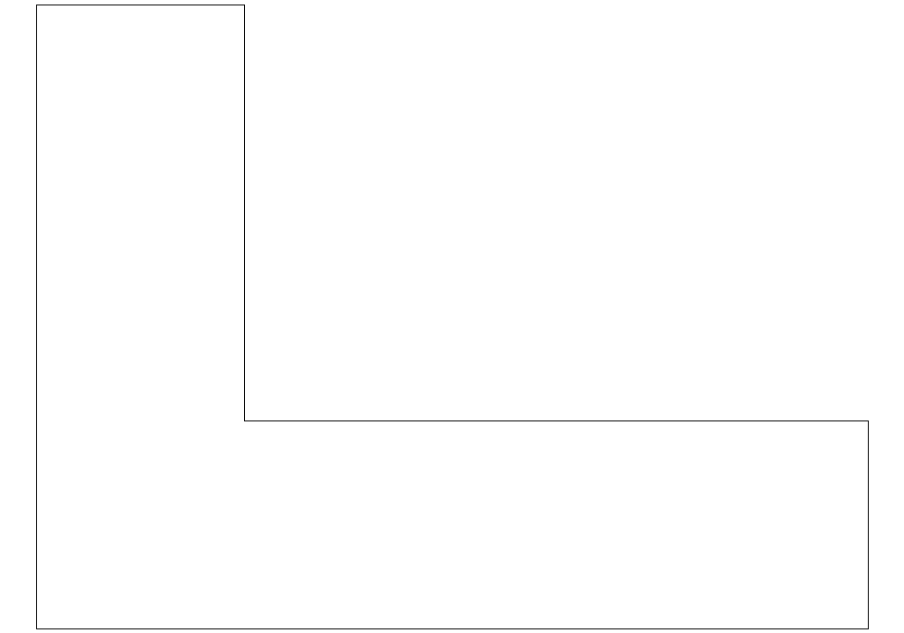 normal_up |  normal_down |  thick |
| 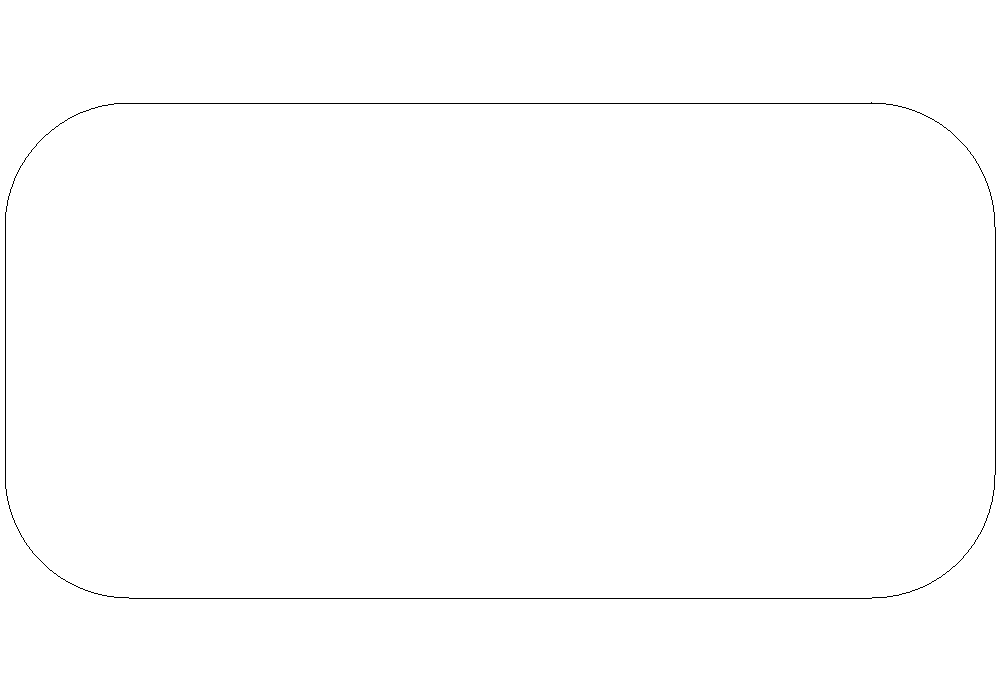 scene_mm |  per_object_bevmod | 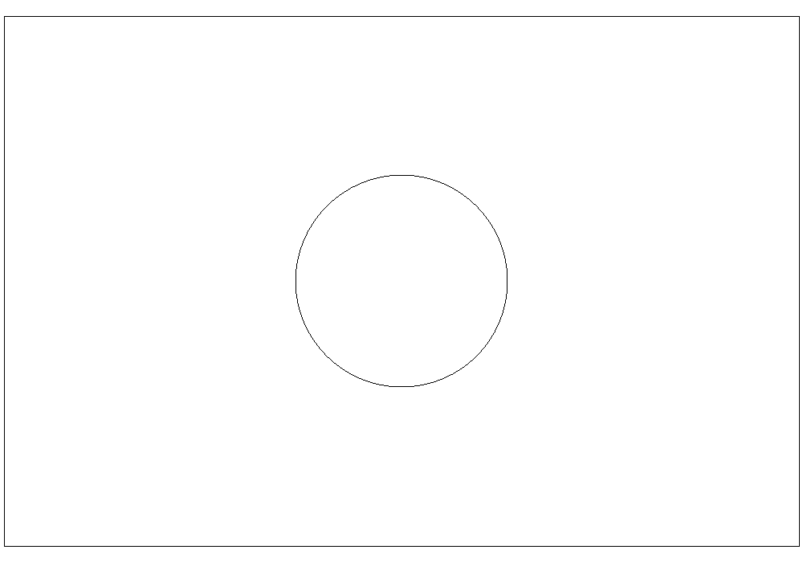 per_object_hole |

Ainda pendente: abrir um DXF no seu programa de corte.

### 2. Interface do Blender com janela

`tests/better_draft/test_gui_v0.py`, executado por `tools/run_gui.ps1`, segue o modelo `gui_async` do Better Item. Uma janela real é aberta (sem `--background`), com `--enable-event-simulate`, perfil isolado e uma sequência de timers. Os menus abrem com `wm.call_menu` na área do 3D Viewport; Escape é enviado com `window.event_simulate`. As capturas são da janela inteira.

Verificações, iguais nas três versões (4.2.0, 4.5.16, 5.3.0: 16/16 cada):

| Verificação | Resultado |
| --- | --- |
| File > Export > Technical Profile (.dxf) | ativo em Object Mode, cinza em Edit Mode (capturas) |
| Menu de contexto do Edit Mode (modo aresta) e menu Edge | Mark as Arc / Mark as Lines / Mark as Automatic no fim de cada menu (capturas) |
| Poll dos operadores | exportar: sim em Object Mode, não em Edit Mode; marcar: só em Edit Mode |
| Mark as Arc nas 8 arestas de um canto | 8 marcadas como arco |
| Mark as Lines nas mesmas arestas | 8 marcadas como linhas |
| Undo 1 | volta às 8 de arco, em Edit Mode |
| Undo 2 | sem marcas, em Edit Mode |
| Redo 1 / Redo 2 | arco, depois linhas |
| Diálogo pelo invoke | abre o navegador de arquivos com os 11 parâmetros nos padrões aprovados (0,7 / 4 / 8 / 0,1 / 0,01 / Local Part / One per Object / 10 / Stop / 1 / Write Report) |
| Cancelar com Escape | navegador fecha, nenhum arquivo na pasta, cena igual |

Observações:
- Os operadores foram chamados com o terceiro argumento posicional `undo=True`, que é como a interface chama um operador ao clicar num item de menu. Sem esse argumento, uma chamada por Python não cria passo de Undo. Isso explica o comportamento visto na primeira rodada em background.
- No painel do diálogo, os rótulos longos aparecem cortados ("Confidence T…", "Fit Tolerance …"). É só cosmético; não mudei.

Capturas: `gui-<versão>/menu_file_export_object_mode.png`, `menu_file_export_edit_mode.png`, `menu_edit_mesh_context.png`, `menu_edit_mesh_edges.png`, `export_dialog.png`.

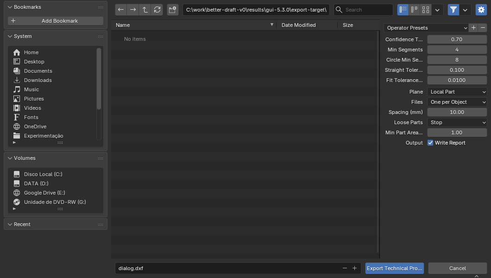

### 3. Versões que faltavam

| Versão | Wheel (offline) | Ponta a ponta |
| --- | --- | --- |
| 4.3.2 | OK | 16/16 |
| 4.4.3 | OK | 16/16 |
| 5.0.1 | OK | 16/16 |
| 5.1.2 | OK | 16/16 |
| 5.2.4 | OK | 16/16 |

Com a primeira rodada (4.2.0, 4.5.16, 5.3.0), são 8 versões Windows, todas com o mesmo ZIP. No Linux, só a sua rodada (4.2.23 e 5.3.0); não executei Linux nem macOS.

### 4. Conflito de bibliotecas

Duas extensões de teste (`tools/conflict_test.ps1`): uma com `pyparsing-3.1.4` e outra com `ezdxf-1.3.5`, ambas wheels oficiais do PyPI com SHA256 conferido. Cada uma foi instalada no mesmo perfil que o Better Draft, nas duas ordens. Depois, `test_conflict_check.py` registra as versões carregadas e exporta um retângulo com cantos arredondados, relendo o DXF.

Dois modos:
- **"prefs":** como uma pessoa faz; as preferências salvas do perfil isolado são carregadas em cada execução.
- **"fs":** cada instalação roda com `--factory-startup` e ignora quais extensões já estão ativas.

| Versão | Modo | 4 combinações (2 libs × 2 ordens) |
| --- | --- | --- |
| 4.2.0 | prefs | todas OK: ezdxf 1.4.5, pyparsing 3.3.3, exportação correta |
| 4.2.0 | fs | Better Draft primeiro: **falha**. A instalação da extensão falsa apaga as wheels do Better Draft (sobra só `pyparsing-3.1.4`, ou `ezdxf-1.3.5` sem `typing_extensions`), e `import ezdxf` falha. Extensão falsa primeiro: OK |
| 4.2.23, 4.5.16, 5.3.0 | prefs e fs | todas OK |

Leitura: com versões diferentes da mesma biblioteca, o Blender mantém a mais nova na pasta compartilhada. Aqui as mais novas são as do Better Draft, que continua exportando. A extensão falsa passa a rodar com as versões do Better Draft.

O defeito é do Blender 4.2.0, já ausente no 4.2.23. Ele só aparece quando a segunda extensão é instalada numa sessão que não sabe que o Better Draft está ativo (por exemplo, com as preferências não salvas).

Nesse caso, a exportação falharia com o traceback de `ModuleNotFoundError: No module named 'ezdxf'`, antes de gravar qualquer arquivo.

Proposta, não aplicada:
- (a) Quando o ezdxf não puder ser importado, recusar com a mensagem "The bundled ezdxf library could not be loaded (another extension may have replaced it). Reinstall Better Draft; on Blender 4.2.0, update to a newer 4.2 LTS release".
- (b) Ou subir o mínimo para 4.2.x. Não sei qual subversão corrigiu o defeito; só testei 4.2.0 (falha) e 4.2.23 (OK).

### 5. Marcações e modificadores

Retângulo 40 × 20 mm com cantos facetados de 3 segmentos; as 3 arestas do primeiro canto estão marcadas como arco. Cada modificador foi testado sozinho, com e sem marcação. Exportação com Loose Parts = All.

| Modificador | Marcas na malha avaliada | Com marcação | Sem marcação |
| --- | --- | --- | --- |
| nenhum | 3 de 16 arestas | 1 ARC R 5 + 13 LINE | 16 LINE |
| Subdivision Catmull-Clark, nível 1 | 6 de 48 | **recusa**: 7 arestas marcadas não cabem num círculo (desvio 0,45 mm) | 32 LINE |
| Subdivision simples, nível 1 | 6 de 48 | **recusa**: desvio 0,098 mm | 16 LINE |
| Bevel em vértices, 1 mm, 2 seg. | 9 de 48 | **recusa**: desvio 0,054 mm | 48 LINE |
| Array ×2 em X | 6 de 32 | 2 ARC (o canto marcado nas duas cópias) + 26 LINE | 32 LINE |
| Mirror em X | 6 de 31 | 2 ARC (canto original e espelhado) + 24 LINE | 30 LINE |
| Solidify 3 mm | 6 de 48 (face de cima e de baixo) | 1 ARC R 5 + 13 LINE | 16 LINE |

As marcas sobrevivem em todos os casos, porque o atributo de aresta é propagado. O que confunde: Subdivision e Bevel deslocam ou cortam os vértices do trecho marcado, que deixa de caber num círculo, e a exportação é recusada com uma mensagem que não cita o modificador.

Proposta, não implementada: quando um arco forçado é recusado e o objeto tem modificadores ativos, acrescentar à mensagem "Marks are read after modifiers (Subdivision, Bevel…) and the marked edges changed. Disable those modifiers for export or mark the edges after applying them". Uma alternativa mais forte é ler as marcas da malha original e ignorar as dos trechos que o modificador alterou; mudaria o comportamento, por isso fica para você decidir.

### 6. Desempenho dentro do Blender

`test_blender_studies.py --study performance`, 3 exportações seguidas; a primeira inclui o carregamento do ezdxf.

| Caso | 4.2.0 (mediana / execuções) | 5.3.0 (mediana / execuções) | Saída |
| --- | --- | --- | --- |
| Chapa 400 × 300 mm, 4 cantos de 256 segmentos, 50 furos de 64 (4 228 vértices) | 3,18 s / 3,56 · 3,18 · 3,17 | 2,74 s / 4,21 · 2,74 · 2,74 | 4 ARC + 4 LINE + 50 CIRCLE |
| 20 objetos (10 chapas com furo de 32, 10 retângulos com Bevel de 16) num arquivo | 0,385 s | 0,337 s | 80 LINE + 40 ARC + 10 CIRCLE |

Não perfilei onde o tempo da chapa grande é gasto.

### 7. Offline de verdade

Não testado. Bloquear a rede do executável exige criar uma regra no Firewall do Windows, que é uma configuração de segurança do sistema; não faço isso. Se você quiser fazer, crie a regra para o `blender.exe` portátil e me avise para eu instalar o ZIP. Para remover a regra depois, use o mesmo nome.

```powershell
New-NetFirewallRule -DisplayName "BD offline test" -Direction Outbound -Program "C:\work\better-draft-v0\portable\blender-4.2.0-windows-x64\blender.exe" -Action Block
```

## Ainda sem teste

- **Rede bloqueada de fato** (item 7).
- **DXF no seu programa de corte:** passo manual seu.
- **Linux e macOS:** só a sua rodada Linux (4.2.23 e 5.3.0).
- **Interface clicada por uma pessoa:** os menus foram abertos de verdade e os operadores chamados como a interface chama, mas os cliques do mouse nos itens não foram simulados.
- **Calibração vs. código final:** as tabelas são anteriores ao mínimo de círculo (8) e à correção do lado do desenho; a lógica de reconhecimento é a mesma.

## Pendências suas

- Nome final do addon.
- Decidir as propostas dos itens 4 e 5.
- Abrir um DXF no seu programa de corte.
- Se quiser o item 7, criar a regra de firewall.
- Push, merge e publicação, quando quiser.
